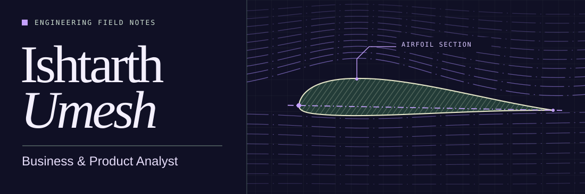
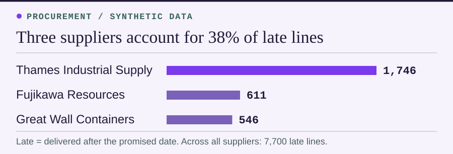
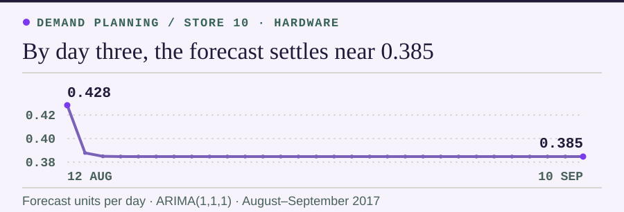

<picture>
  <source media="(max-width: 600px)" srcset="./assets/portfolio/cover-mobile.svg">
  
</picture>

  <a href="#selected-projects">Explore my work</a> ·
  <a href="#experience">Experience</a> ·
  <a href="#toolkit">Toolkit</a> ·
  <a href="https://www.linkedin.com/in/ishtarth-umesh-497582170/">LinkedIn</a> ·
  <a href="mailto:ishtarthumesh06@gmail.com">Contact me</a>

**Boston, MA · Tufts Engineering Management ’27 · Former Business Analyst at KPMG**

I connect business questions to the data needed to answer them. My background spans aerospace engineering, three years at KPMG, and a Master of Engineering Management at Tufts. I’m interested in **business analyst, product analyst, and operations analytics opportunities**.

At KPMG, I built data pipelines and executive reporting. Here, I’m sharing projects that investigate supplier performance and retail demand. Click either project to inspect the implementation, or expand its notes to see how the analysis works.

## Selected projects

### Procurement Performance Dashboard

**Which suppliers deserve a closer look?**

In this synthetic demo, Thames Industrial Supply had **1,746 late lines out of 1,848 (94.5%)**, compared with **16.3% across all suppliers**. The dashboard helps a buyer follow that gap into delivery, quality, and price history.

**Python · pandas · Streamlit · Plotly · scikit-learn**

[Explore repository →](https://github.com/IshtarthUmesh/Procurement-Performance-Dashboard) · [View dashboard screenshot →](https://github.com/IshtarthUmesh/Procurement-Performance-Dashboard/blob/main/assets/screenshots/vendor-risk.png)

<b>Explore the analysis — spend, savings, and supplier risk</b>

- **Scope.** Five dashboard pages analyze 47,128 synthetic purchase-order lines, 106 suppliers, and 10 categories.
- **Price changes.** Like-for-like item comparisons help distinguish a price increase from a change in the purchase mix.
- **Vendor risk.** A weighted performance scorecard combines with Isolation Forest anomaly detection.
- **Savings opportunities.** Price variance, off-contract spend, supplier consolidation, and potential duplicate payments are evaluated using stated assumptions.

Savings figures are estimates from synthetic data. A buyer would validate the transactions and sourcing assumptions before acting.

[Read the savings implementation](https://github.com/IshtarthUmesh/Procurement-Performance-Dashboard/blob/main/views/savings_opportunities.py) · [Inspect the risk model](https://github.com/IshtarthUmesh/Procurement-Performance-Dashboard/blob/main/src/risk_features.py)

### Retail Demand Planning

**What should a planner make of a flat forecast?**

Select a store and product family to produce a **30-day sales forecast** using ARIMA(1,1,1). The published hardware example for store 10 settles near **0.385 daily sales units** by day three. The script plots the forecast beside 60 historical observations to support closer inspection.

**Python · pandas · statsmodels · Matplotlib**

[Explore repository →](https://github.com/IshtarthUmesh/Retail-Demand-Planning) · [Compare forecast with history →](https://github.com/IshtarthUmesh/Retail-Demand-Planning/blob/main/forecast_plot.png)

<b>Explore the workflow — preparation, model, and outputs</b>

1. Select a store and product family from the retail dataset.
2. Sort daily observations and inspect stationarity with the Augmented Dickey–Fuller test.
3. Fit the fixed ARIMA(1,1,1) model.
4. Generate 30 daily estimates and save the chart and CSV.

The published sample is a model output. Before operational use, I would evaluate forecast error against a held-out period and compare with a simple baseline.

[Read the Python script](https://github.com/IshtarthUmesh/Retail-Demand-Planning/blob/main/demand_forecasting.py) · [Inspect the sample CSV](https://github.com/IshtarthUmesh/Retail-Demand-Planning/blob/main/forecast_store10_hardware.csv)

## Experience

**KPMG · Business Analyst · 2022–2025**

Built SQL and PySpark reporting used daily by **20+ executives**. Worked with operations teams to improve data pipelines and help identify **more than $1 million in potential cost savings**. Recognized with the **Rising Star** and **Client Service Excellence** awards.

<b>Follow my journey — aerospace engineering to business analytics</b>

**2018–2022 · BMS College, Bengaluru**

B.E. in Aerospace Engineering. Systems thinking, root-cause analysis, and engineering discipline.

**2022–2025 · KPMG**

Business analysis, data pipelines, executive reporting, validation, and stakeholder delivery.

**2025–2027 · Tufts University, Boston**

Master of Engineering Management. Technology strategy, customer discovery, and financial analysis.

## Toolkit

**Analysis & reporting** · SQL, Python, pandas, Power BI, PySpark, Excel

**Project implementation** · Streamlit, Plotly, statsmodels, scikit-learn, Matplotlib

**Business practice** · Stakeholder discovery, requirements, KPI definition, process mapping, UAT

<b>How I approach a business problem</b>

Start with the stakeholder’s decision. Define the business question and the metric. Trace the data and validate assumptions. Build the analysis, explain the tradeoffs, and make the next action clear.

## Let’s work together

Looking for someone who can move between stakeholder conversations and the underlying data? I’d welcome a conversation about **business analysis, product analytics, or strategy and operations**.

[Connect on LinkedIn →](https://www.linkedin.com/in/ishtarth-umesh-497582170/) · [Email Ishtarth →](mailto:ishtarthumesh06@gmail.com)
