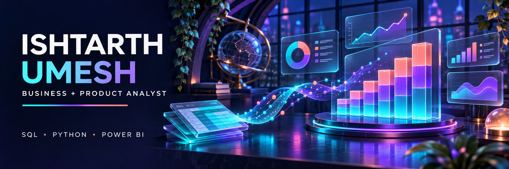
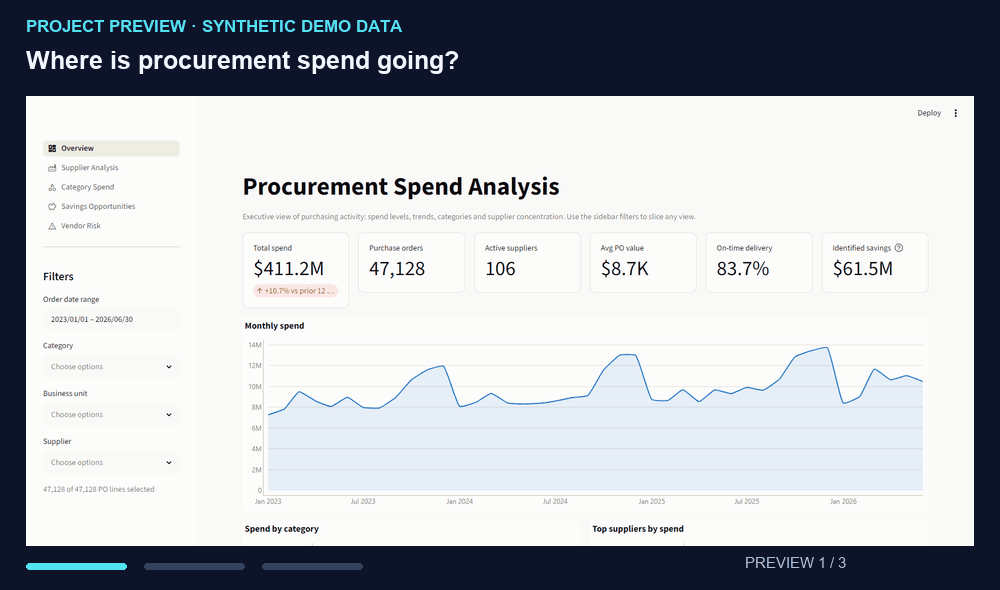
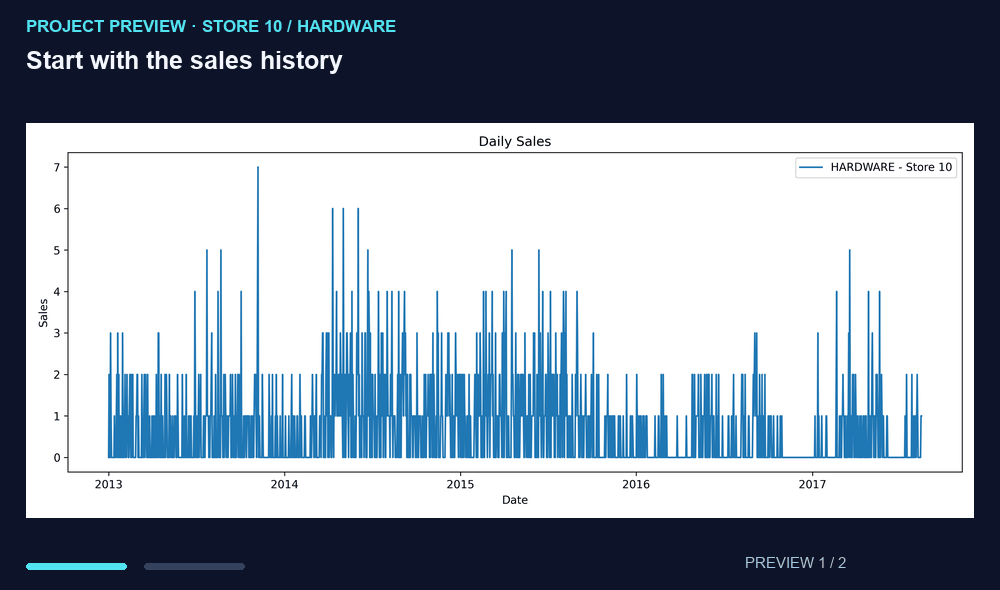
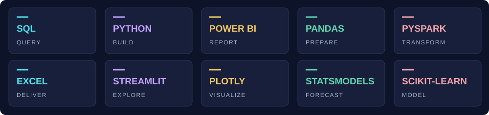

  
  
  

<b>Boston, MA · Tufts MEM ’27 · Ex-KPMG</b> 
Business analysis · Product analytics · Strategy &amp; operations

## Hi, I’m Ishtarth 👋

I help teams turn business questions into analysis they can act on. At **KPMG**, I worked on data pipelines, validation, and executive reporting. At **Tufts**, I’m building on that experience through engineering management, customer discovery, and technology strategy.

My public work explores two operational decisions — **where procurement teams should investigate risk** and **how planners can forecast retail demand**.

[Projects](#featured-projects) · [Experience](#experience--impact) · [Tools](#tools-i-work-with) · [Contact](#lets-talk)

## Experience & impact

| Potential savings identified | Daily executive users | KPMG awards |
| :---: | :---: | :---: |
| **$1M+** | **20+** | **2** |

**Business Analyst at KPMG · 2022–2025**

Worked with operations teams on data pipelines and SQL/PySpark reporting. Recognized with the **Rising Star** and **Client Service Excellence** awards.

## Featured projects

### 🛒 Procurement Performance Dashboard

**Find the spend patterns, savings opportunities, and suppliers that need attention.**

An interactive Streamlit dashboard with five views covering procurement spend, supplier performance, category prices, savings opportunities, and vendor risk. It analyzes **47,128 synthetic purchase-order lines across 106 suppliers**.

**Python · pandas · Streamlit · Plotly · scikit-learn**

[**Explore the repository ↗**](https://github.com/IshtarthUmesh/Procurement-Performance-Dashboard) · [View full-size dashboard](https://github.com/IshtarthUmesh/Procurement-Performance-Dashboard/blob/main/assets/screenshots/vendor-risk.png)

<b>🔍 Open the case study — business question, implementation, and findings</b>

**The business question**

Where should a procurement team focus its next supplier review?

**What the implementation does**

- Compares like-for-like item prices to help distinguish inflation from a change in the purchase mix.
- Estimates opportunities in off-contract spending, price variance, consolidation, and potential duplicate payments.
- Combines a weighted supplier scorecard with Isolation Forest anomaly detection.
- Recalculates views when date, supplier, category, or business-unit filters change.

**A concrete finding**

In the synthetic dataset, Thames Industrial Supply had **1,746 late lines out of 1,848 (94.5%)**. The rate across all suppliers was **16.3%**. That difference gives a buyer a starting point for investigation.

**How to interpret the demo**

The data is synthetic. Savings figures are addressable estimates based on stated assumptions, and suspected duplicates need validation.

[Inspect savings calculations](https://github.com/IshtarthUmesh/Procurement-Performance-Dashboard/blob/main/views/savings_opportunities.py) · [Inspect risk scoring](https://github.com/IshtarthUmesh/Procurement-Performance-Dashboard/blob/main/src/risk_features.py)

### 📈 Retail Demand Planning

**From daily sales history to a 30-day forecast for a selected store and product family.**

A Python forecasting workflow using **ARIMA(1,1,1)**. The script plots predictions beside the latest **60 historical observations** and exports daily forecasts to CSV.

**Python · pandas · statsmodels · Matplotlib**

[**Explore the repository ↗**](https://github.com/IshtarthUmesh/Retail-Demand-Planning) · [Inspect sample forecast CSV](https://github.com/IshtarthUmesh/Retail-Demand-Planning/blob/main/forecast_store10_hardware.csv)

<b>🔍 Open the case study — forecasting workflow and interpretation</b>

**The business question**

How can historical daily sales inform near-term demand planning?

**The workflow**

1. Choose a store and product family.
2. Prepare daily observations and inspect stationarity with the Augmented Dickey–Fuller test.
3. Fit the fixed ARIMA(1,1,1) model.
4. Generate 30 daily estimates and save a chart and CSV.

**What the example shows**

The published hardware forecast for store 10 settles near **0.385 daily sales units** by day three. Viewing it alongside historical sales helps a planner question whether the model captures the pattern well.

**What I would evaluate before operational use**

Forecast error on held-out data and performance against a simple baseline.

[Read the forecasting script](https://github.com/IshtarthUmesh/Retail-Demand-Planning/blob/main/demand_forecasting.py) · [View original forecast chart](https://github.com/IshtarthUmesh/Retail-Demand-Planning/blob/main/forecast_plot.png)

## Tools I work with

<b>🧰 Explore my toolkit by the work it supports</b>

| Work | Tools & methods |
| --- | --- |
| Query, prepare, validate | SQL · Python · pandas · PySpark |
| Explain results | Power BI · Excel · Plotly · Matplotlib |
| Build analytical applications | Streamlit · scikit-learn · statsmodels |
| Connect analysis to delivery | Stakeholder discovery · requirements · KPI definition · process mapping · UAT |

<b>🎓 Follow my journey</b>

**BMS College · 2018–2022**

B.E. in Aerospace Engineering, Bengaluru.

**KPMG · 2022–2025**

Business analysis, data pipelines, validation, and executive reporting.

**Tufts University · 2025–2027**

Master of Engineering Management, Boston. Technology strategy, customer discovery, and financial analysis.

## Let’s talk

I’m interested in **business analyst, product analyst, and operations analytics opportunities** where I can connect stakeholder needs with reliable analysis.

[**Connect on LinkedIn ↗**](https://www.linkedin.com/in/ishtarth-umesh-497582170/) · [**Email me ↗**](mailto:ishtarthumesh06@gmail.com)

Project GIFs show actual repository screenshots. Header artwork is illustrative.
