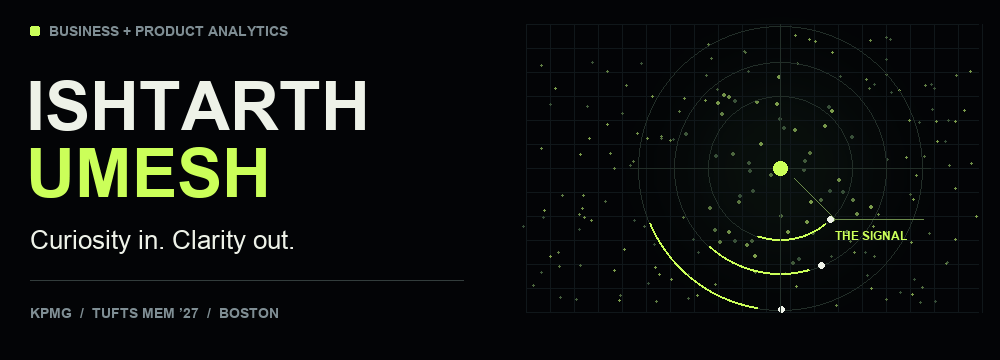
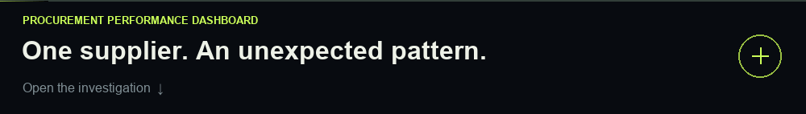
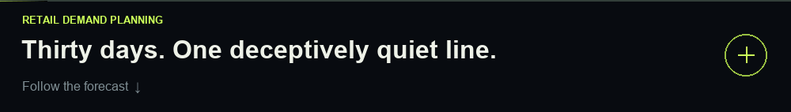

<b>I investigate the patterns behind business decisions.</b> 
Business analyst · Product analyst · Operations analytics

  <a href="https://www.linkedin.com/in/ishtarth-umesh-497582170/">Meet me on LinkedIn ↗</a> &nbsp;·&nbsp;
  <a href="mailto:ishtarthumesh06@gmail.com">Start a conversation ↗</a>

### Pick a question.

### The supplier worth calling first

In the synthetic procurement dataset, **94.5%** of Thames Industrial Supply’s order lines arrived late. The rate across all suppliers was **16.3%**. That gap gives a buyer somewhere specific to start.

**Procurement Performance Dashboard** · Python · pandas · Streamlit · Plotly · scikit-learn

Five interactive views explore **47,128 synthetic order lines and 106 suppliers**. The implementation compares like-for-like prices, estimates savings opportunities, and combines a weighted vendor scorecard with Isolation Forest anomaly detection.

Savings are addressable estimates from synthetic data, with stated assumptions.

[**Open the repository ↗**](https://github.com/IshtarthUmesh/Procurement-Performance-Dashboard) · [Inspect the risk model](https://github.com/IshtarthUmesh/Procurement-Performance-Dashboard/blob/main/src/risk_features.py) · [View full-size dashboard](https://github.com/IshtarthUmesh/Procurement-Performance-Dashboard/blob/main/assets/screenshots/vendor-risk.png)

### A flat line deserves a second look

The published hardware forecast for store 10 settles near **0.385 daily sales units** by day three. Does that tell a planner enough to make an inventory decision? Start by comparing it with the sales history.

**Retail Demand Planning** · Python · pandas · statsmodels · Matplotlib

Select a store and product family, inspect stationarity, fit **ARIMA(1,1,1)**, and export **30 daily estimates**. The chart places the forecast beside the most recent **60 observations**.

Before operational use, I would evaluate held-out forecast error and compare against a simple baseline.

[**Open the repository ↗**](https://github.com/IshtarthUmesh/Retail-Demand-Planning) · [Read the model implementation](https://github.com/IshtarthUmesh/Retail-Demand-Planning/blob/main/demand_forecasting.py) · [Inspect the forecast CSV](https://github.com/IshtarthUmesh/Retail-Demand-Planning/blob/main/forecast_store10_hardware.csv)

<b>The person behind the analysis ↴</b>

### Hi, I’m Ishtarth.

I spent three years as a **Business Analyst at KPMG**, working on data pipelines, validation, and executive reporting. I’m now pursuing my **Master of Engineering Management at Tufts, class of 2027**, in Boston.

My work with operations teams helped identify **more than $1 million in potential savings**. I built SQL and PySpark reports used daily by **20+ executives**, and earned KPMG’s **Rising Star** and **Client Service Excellence** awards.

**My toolkit**

SQL · Python · Power BI · pandas · PySpark · Excel · Streamlit · Plotly · statsmodels · scikit-learn

**How I work**

Understand the stakeholder’s decision. Define the question. Validate the data. Investigate the pattern. Explain what to do next.

I’m interested in **business analyst, product analyst, and operations analytics opportunities**.

[Let’s talk on LinkedIn](https://www.linkedin.com/in/ishtarth-umesh-497582170/) · [Email me](mailto:ishtarthumesh06@gmail.com)

Two projects. Follow the question, then inspect the evidence.

